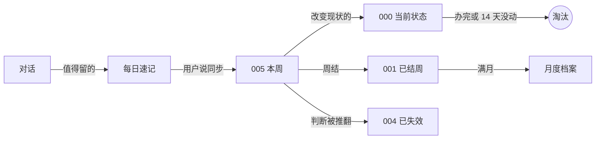

# 弈溯 · 分层记忆库

给 AI 助手用的长期记忆结构，放在一个 Obsidian 库里，由 Claude Code 或 Codex 读写。

让 AI 记住一个人不难。难的是让它知道什么该忘、什么已经不成立，以及哪些话是这个人说的、哪些是它自己推出来的。这个仓库是一套处理这三件事的规则、一个同步技能和两个带测试的脚本，附带一个可以直接跑的虚构示例库。

结构来自一个每天在用的私人记忆库。这里只有结构和规则，示例里的人物与事件全部是虚构的。

## 五层

| 层 | 放什么 | 文件 |
| --- | --- | --- |
| 规则 | 怎么读、怎么写 | `CLAUDE.md`、`AGENTS.md`、`.codex/SYNC_WORKFLOW.md`、`.codex/SYNC_MAINTENANCE.md`、脚本 |
| 当前 | 平时会读 | `000` 当前状态、`002` 人物与偏好、`003` 字典、`005` 本周 |
| 历史 | 追溯时才读 | `001` 已结周、月度档案、人物历史卡、低频词条、`004` 已失效判断 |
| 底账 | 核对原话和来源 | `记忆/原始对话/`、`.codex/daily/` 每日速记 |
| 版本 | 只用于恢复 | 库根目录的本地 git，每次同步一次提交 |

新事实进当前层，不再活跃的往下沉，重新活跃的再搬回来。底账永远不当作当前事实。

## 一条事实怎么走



还没同步的速记不用等：下一次新对话开始时就会被读到。

## 设计决定

**当前状态有上限。** `000` 是快照，不是流水账。目标 5,000 字以内，超过 6,000 字校验直接不过。每次同步既要加也要删：办完的事、14 天没有进展也没有下一步的事，都要淘汰。每周、每月重复的安排单独放在“固定日程”里，不受 14 天规则影响，因为它们本来就不会有“新进展”。

**新对话先读最新的。** 每次开新对话，先整份读 `000`，再读当天和前一天还没同步的速记。`000` 有上限，正是为了整份读也不贵。这样用户昨天说过的事，今天不用再说一遍。

**一天只存在于一个地方。** 当周的事只写在 `005`，周结后原文迁进 `001`，满月再迁进月度档案。同一天不会同时出现在两个文件里。

**推翻的判断留底。** 一个判断被事实否定后，不是悄悄改掉，而是连同失效的证据和日期一起移进 `004`。之后默认不再调用，只在复盘时读。

**事实、推断、计划分开写。** 每条事件都分“事实”和“解释/推断”两块。“这周五之前投”是计划，不是已经投了。

**AI 造的词不算用户说的。** 记录是 AI 整理出来的，以后还会被 AI 自己读回去。为了不让它把自己的分析当成证据，规则要求：引号只给原话，助手为了检索起的标签始终算助手的，需要判断语气和措辞时回到原始对话去查。

**按睡眠分日，不按零点。** 过了零点还没睡，这段对话仍然算前一天。日历上固定的事（约好的时间、截止日期）保留真实日期。

**用不上的词条会降级。** 字典只收预计会用到两次以上的词。长期没被提到的词条原样移进低频索引，不删除，重新用到时再搬回来。字典超过 100 条时校验会提醒。

**习惯写进库里，不写进某个工具。** 用户教过的协作习惯（比如“先查记录再问”）写在 `AGENTS.md` 里，`CLAUDE.md` 自动导入它。这样换了工具、换了电脑，规矩还在。

**历史交给本地 git。** 每次正式同步从干净的工作区开始、以一次提交结束，要回退就从 git 里取，不再每次同步前拷一个备份文件夹。这个 git 只在本地：不设远端，还装一个拒绝推送的钩子，因为记忆库里是最私密的东西。

另外，写入必须有明确授权。“帮我总结一下今天”只是聊天，不会改任何文件。

## 试一下

需要 Python 3.10 以上，不需要安装任何依赖。

```bash
git clone https://github.com/Silvius-Eee/yisu-memory.git
```

```bash
cd yisu-memory
```

```bash
python3 .agents/skills/obsidian-daily-sync/scripts/validate_sync.py --mode daily --date 2026-11-10
```

示例库会通过，并给出一条提醒：

```text
WARNING 002_人际与偏好.md: demotion candidate 陈教练, last dated 2026-08-20
VALIDATION PASSED mode=daily 001_closed_days=3 005_staged_days=3 004_sha256=...
```

那条提醒的意思是：弱连接里的陈教练已经超过 60 天没有新互动，可以考虑把卡片降到历史档案。脚本只提醒，搬不搬由用户决定。

把本周的某一天手动复制一份到 `001` 里再跑一次，会得到：

```text
VALIDATION FAILED
- 001_记忆库.md: body/index mismatch; missing links=['2026-11-08'], extra links=[]
- 001_记忆库.md: 2026-11-08 has no #### event section
- 001/005: active-week dates must not be duplicated ['2026-11-08']
```

示例库里还有一份 11 月 11 日、还没同步的速记（`.codex/daily/2026-11-11.md`）。用 Claude Code 或 Codex 打开这个目录，问一句“重组的结果出来了吗”，助手应该能直接从速记里答出来，而不是去问你。

## 校验脚本查什么

- 日条目的标题层级、时间顺序、有没有重复。
- 正文和索引是不是一一对应。
- 同一天有没有同时出现在 `001` 和 `005`。
- `005` 声明的那一周是不是周日到周六，条目有没有越界。
- 每日速记在正式同步后是不是已经收尾，有没有残留的待处理项。
- `000` 有没有超长；人物卡有没有超过 2,500 字；字典有没有超过 100 条。
- 人物短卡的链接能不能找到完整卡，同一个人有没有两张完整卡。
- `004` 在一次普通同步里有没有被意外改动（比对哈希）。

它只查结构，不判断内容对不对。一条记错的事实，只要格式正确，照样能通过。内容上的把关靠的是同步规则和用户自己的验收。

## 测试

```bash
python3 -m unittest discover -s tests
```

49 个测试。校验脚本的每一种报错和提醒，都在示例库的副本上故意造一次，确认它真的会报；导出脚本用假的对话记录，确认系统提示会被过滤、子任务和项目子文件夹里的对话会被跳过、排除清单生效、短的导出不会覆盖长的。

## 用在自己的库里

1. 把 `AGENTS.md`、`CLAUDE.md`、`.codex/`、`.agents/` 和 `记忆/` 复制到你的 Obsidian 库根目录。
2. 清空 `记忆/` 和 `.codex/daily/` 里的示例内容，保留每个文件开头的说明和标题结构。
3. 在 `CLAUDE.md` 的第一节写上你想要的称呼和语气。
4. 把 `.agents/skills/obsidian-daily-sync/vault.example.json` 复制成同一目录下的 `vault.json`，改成你自己的设置。
5. 在库根目录建一个只在本地的 git，并装上拒绝推送的钩子（见下面三条命令）。
6. 用 Claude Code 或 Codex 打开这个目录开始聊天。想归档时明确说“同步到 Obsidian”。

```bash
git init
```

```bash
cp .agents/skills/obsidian-daily-sync/pre-push .git/hooks/pre-push && chmod +x .git/hooks/pre-push
```

```bash
git add -A && git commit -m "初始快照"
```

如果库里还有大文件或别的项目（视频、依赖、子仓库），先在 `.gitignore` 里排除，只让 git 管记忆系统本身。注意别把这个仓库本身当成你的库：这个仓库是公开模板，你的库是私人的。

`vault.json` 能设四项：记忆文件夹名、速记文件夹、导出对话里你的称呼、时区。不写就用默认值。脚本本身在每个库里都一样，以后更新只需要替换 `scripts/` 文件夹，你的设置不受影响。

六个记忆文件按编号前缀识别（`000_*.md` 到 `005_*.md`），后面的名字可以随意改。

`export_transcripts.py` 会读取本机的 Claude Code 和 Codex 对话记录，把属于这个库的对话导出到 `记忆/原始对话/`。全程在本地，不联网。

## 目录

```text
AGENTS.md                        读取规则和协作习惯
CLAUDE.md                        身份和边界，导入 AGENTS.md
.codex/SYNC_WORKFLOW.md          每次同步都用的写入规则
.codex/SYNC_MAINTENANCE.md       周结、人物卡迁移、月度归档等低频维护
.codex/daily/                    每日速记
.agents/skills/obsidian-daily-sync/
  SKILL.md                       同步技能入口
  vault.example.json             设置示例
  pre-push                       拒绝推送的 git 钩子，装进你自己的库
  scripts/validate_sync.py       结构校验
  scripts/export_transcripts.py  导出原始对话
  scripts/vault_config.py        读取设置
tests/                           测试
记忆/                            虚构示例库
```

规则文件是英文写的，因为它们是给模型读的；记忆内容和这份说明是中文。

## 来历

它最早只是一段几千字的角色提示词，记忆、规则和语气全挤在一起。后来加了一条“事实一致性优先于角色演绎”，再后来记忆被拆成分层的文件，读和写的规则各自独立，最后补上了校验脚本和测试。现在身份、读取规则、写入规则和校验是四样分开的东西。

弈溯是这个助手的名字。

## 许可

MIT
